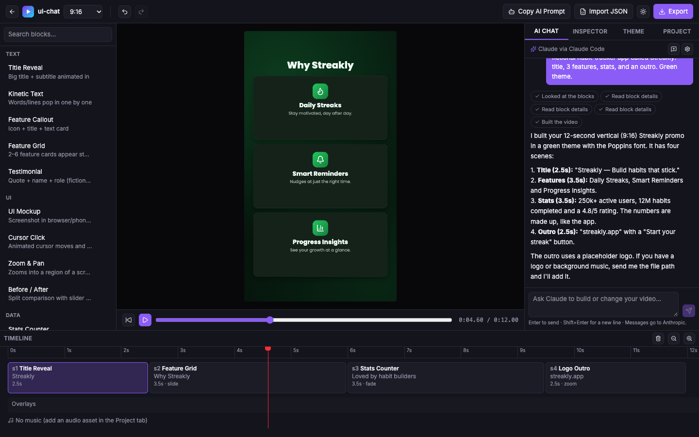

# Clipai

**A free, open-source, local video editor for animated and SaaS-style videos — built to be controlled by AI.**

You describe the video. Your AI assistant (Claude Code, Claude Desktop, or any MCP client) builds it in the editor through a small set of tools. You watch the live preview, adjust anything by hand, and export the MP4 on your own computer.

---

## Why it exists

- **Token-efficient.** The AI sends short JSON instructions ("add a feature-callout scene, 3 seconds"), not hundreds of lines of animation code. Prebuilt animation blocks do the heavy lifting.
- **100% local.** Runs on your machine. No account, no cloud, no telemetry.
- **Truly free.** MIT licensed, with its own rendering engine. Free for individuals **and companies of any size**, including commercial use.
- **Hackable.** Anyone can add new animation blocks as plugins.

---


## Features

- Live preview player with timeline (drag to reorder, drag edges to resize), inspector forms generated from each block's schema, theme tab, undo/redo
- 16 prebuilt blocks: title reveal, kinetic text, UI mockup (browser / phone / laptop frame), cursor click, zoom & pan, feature callout, feature grid, stats counter, before/after, testimonial, pricing cards, logo outro, animated backgrounds, plus lower-third, captions and watermark overlays
- Transitions: fade, slide, zoom, wipe
- Formats: 16:9, 9:16 (Reels / Shorts), 1:1 — at 720p or 1080p, 30 or 60 fps
- Themes: brand colors, font and corner radius applied across the whole video
- Export to MP4 (H.264 + AAC) directly in the browser using WebCodecs — preview and export use the exact same renderer
- Background music with volume and fade-out
- Bangla font support out of the box (Hind Siliguri, Noto Sans Bengali)
- **Built-in AI chat**: type what you want in the editor and Claude builds it live, using your Claude Code login or an Anthropic API key
- Other ways to work with AI: MCP (Claude Code, Claude Desktop, Cursor…), Paste mode (any AI chat), or manual editing
- Plugin blocks: drop a `.js` file into `blocks/`


| 16:9 | 9:16 |
| --- | --- |
|  |  |

---

## Requirements

- Node.js 20 or newer and [pnpm](https://pnpm.io) (`npm i -g pnpm` or `corepack enable`)
- Chrome or Edge (recommended for export — uses WebCodecs)
- Windows, macOS, or Linux

---

## Quick start

```bash
git clone https://github.com/ferdousmikdad/Clipai.git
cd Clipai
pnpm install
pnpm build
pnpm start
```

Open the URL shown in the terminal (default `http://127.0.0.1:4400`). Click **Add example projects** to load three demo videos.

Projects are saved as plain folders in `./projects/<project-name>/` (a `project.json` file plus an `assets/` folder). Exports go to `./projects/<project-name>/exports/`.

Options: `pnpm start --port 4401` (or `CLIPAI_PORT`), `--projects <dir>` (or `CLIPAI_PROJECTS`).

Keyboard: <kbd>Space</kbd> play/pause · <kbd>←</kbd>/<kbd>→</kbd> step one frame (<kbd>Shift</kbd> = 1 s) · <kbd>Ctrl/Cmd+Z</kbd> undo · <kbd>Ctrl/Cmd+Shift+Z</kbd> redo · <kbd>Delete</kbd> remove the selected scene/overlay. Drop images or audio anywhere on the editor to add them as assets.

---

## Chat with Claude inside Clipai

The editor has an **AI Chat** tab (right panel). Type what you want, for example *"Make a 20-second promo for my app with 4 scenes, green theme"*, and Claude builds it while you watch the preview and timeline update. You don't need another app or editor.



Clipai connects to Claude in one of two ways. Pick one in the chat's settings (gear icon); by default it uses whichever is available:

| | Claude Code login (recommended) | Anthropic API key |
| --- | --- | --- |
| Setup | Install [Claude Code](https://claude.com/claude-code) and run `claude` once to sign in | Paste a key from [console.anthropic.com](https://console.anthropic.com) into chat settings, or set `ANTHROPIC_API_KEY` |
| Billing | Your Claude plan | Pay per use (model `claude-opus-5-5`) |
| How it works | Clipai runs Claude Code in the background with **no file, shell or web tools**, only Clipai's own tools for the open project | Clipai calls the Anthropic API directly with the same tools |

Notes:

- Claude only edits the project you have open. Every change can be undone (<kbd>Ctrl/Cmd+Z</kbd>).
- To use your own screenshots, logos or music, drop the files onto the editor, or give Claude the file path.
- A saved API key is stored only on your computer, in `.clipai/settings.json` (gitignored, owner-only permissions). The editor never shows the key again after you save it.
- **New chat** (the icon next to the gear) starts a fresh conversation.

---

## Connect your AI

Clipai's MCP server is a small stdio program that relays your AI's commands to the running editor. Setup takes two steps.

### 1. Start Clipai

Follow the [Quick start](#quick-start) (`pnpm build` creates `packages/mcp/dist/index.js`) and keep `pnpm start` running. If the editor isn't running, every tool replies `Editor not running. Run "pnpm start" in the Clipai folder.`

You need the **absolute path** to the Clipai folder: run `pwd` inside it (macOS/Linux) or `cd` (Windows).

### 2. Register the MCP server

#### Claude Code

```bash
claude mcp add clipai -- node /absolute/path/to/Clipai/packages/mcp/dist/index.js
```

Type `/mcp` inside Claude Code to check that `clipai` shows as connected.

#### Claude Desktop

Open **Settings → Developer → Edit Config**, or edit the file directly:

- macOS: `~/Library/Application Support/Claude/claude_desktop_config.json`
- Windows: `%APPDATA%\Claude\claude_desktop_config.json`

```json
{
  "mcpServers": {
    "clipai": {
      "command": "node",
      "args": ["/absolute/path/to/Clipai/packages/mcp/dist/index.js"]
    }
  }
}
```

On Windows, escape backslashes: `"C:\\Users\\me\\Clipai\\packages\\mcp\\dist\\index.js"`. Quit and reopen Claude Desktop; Clipai's tools appear in the tools menu.

#### Other MCP clients (Cursor, Windsurf, …)

Use command `node` with the path to `packages/mcp/dist/index.js` as the argument (stdio transport).

#### Different port

If you started Clipai with `pnpm start --port 4401`, tell the MCP server:

- Claude Code: `claude mcp add clipai -e CLIPAI_PORT=4401 -- node /absolute/path/to/Clipai/packages/mcp/dist/index.js`
- Claude Desktop: add `"env": { "CLIPAI_PORT": "4401" }` next to `"args"`.

### 3. Ask for a video

Keep the editor open in Chrome or Edge, then ask something like:

> Make a 30-second 16:9 promo for my app "TaskFlow". Dark theme, purple accent. Show the dashboard screenshot in a browser frame, highlight 3 features, end with the logo.

Changes appear in the editor live. To use your own screenshots or music, give the AI the file path; it adds them with `add_asset`.

MCP tools (responses are kept short to save tokens): `list_blocks`, `get_block`, `list_projects`, `create_project`, `open_project`, `set_project`, `apply_ops`, `get_summary`, `get_project`, `add_asset`, `snapshot`, `export_video`. A first draft usually takes 3–4 tool calls; each edit is one `apply_ops` call. `snapshot` and `export_video` need the editor open in Chrome or Edge.

### Troubleshooting

| Symptom | Fix |
| --- | --- |
| "Editor not running" | Run `pnpm start` and keep that terminal open |
| Tools don't show up | Check the path is absolute and `packages/mcp/dist/index.js` exists (run `pnpm build`), then restart the client |
| "No editor open" on snapshot or export | Open http://127.0.0.1:4400 in Chrome or Edge |
| Export fails | Use Chrome or Edge; Firefox and Safari lack the H.264 encoder Clipai needs |

### Paste mode (any AI, no setup)

1. In the editor, click **Copy AI Prompt**. It copies a short guide with the project format and the block list.
2. Paste it into any AI chat with your video request.
3. Copy the JSON it returns, click **Import JSON**, paste. Done.

---

## Development

```text
packages/schema   types, Zod schemas, ops, validation, summary()
packages/engine   deterministic Canvas renderer, timing, animation helpers, font loader
packages/blocks   built-in blocks (one file per block)
packages/server   local server + CLI (REST, WebSocket, file store)
packages/mcp      MCP stdio server
apps/editor       React UI (Vite, Zustand, Tailwind)
examples/         demo projects (fictional brands only)
docs/             schema.md, blocks.md (plugin tutorial), ai-prompt.md
```

```bash
pnpm build             # build everything
pnpm test              # unit + API + MCP tests (Vitest)
pnpm test:e2e          # export smoke test in Chrome (Playwright)
pnpm lint
pnpm dev               # editor with hot reload (run `pnpm start` alongside for the API)
pnpm licenses:check    # fail on non-allowed dependency licenses
pnpm licenses:notice   # regenerate THIRD_PARTY_NOTICES.md
```

See [`docs/schema.md`](./docs/schema.md) for the project format and API, and [`docs/blocks.md`](./docs/blocks.md) to build your own block.

---

## License

The code in this repository is released under the **MIT License** — see [LICENSE](./LICENSE).

You may use, copy, modify, fork, and distribute it, for personal or commercial purposes, for free. **This applies to individuals and companies of any size.** No paid license from any third party is required to use this tool.

---

## Notices

### Independent rendering engine

Clipai uses its **own rendering engine** (HTML Canvas + WebCodecs). It does **not** include, bundle, or depend on Remotion or any other source-available video framework that requires a commercial license. Contributors must not add such dependencies (see [CONTRIBUTING](#contributing)).

### Third-party software

Clipai depends on open-source packages that keep their own licenses (MIT, ISC, BSD, Apache-2.0, MPL-2.0, or Unlicense). A full list is generated in [`THIRD_PARTY_NOTICES.md`](./THIRD_PARTY_NOTICES.md) with:

```bash
pnpm licenses:notice
```

FFmpeg is **not** bundled. Video encoding uses the browser's built-in WebCodecs API.

### Fonts and icons

Bundled fonts are licensed under the **SIL Open Font License 1.1** (e.g., Inter, Poppins, Hind Siliguri, Noto Sans Bengali). Icons are from **Lucide** (ISC License). Their license files are included in `assets/licenses/`.

### Your content

- Videos you create with Clipai belong to you. The project claims no ownership over your output.
- **You are responsible** for having the rights to any images, screenshots, logos, music, fonts, or other media you import into your projects.
- Demo templates use fictional product names and placeholder graphics only.

### Trademarks

"Claude" is a trademark of Anthropic. Clipai is an independent project and is **not affiliated with, endorsed by, or sponsored by Anthropic** or any other AI provider. Other product names mentioned are the property of their respective owners and are used only for identification.

### Privacy

Clipai runs entirely on your computer. It collects **no telemetry**. The local server listens only on `127.0.0.1`. The only data that leaves your machine is what you send to an AI: when you use the built-in chat, your messages, the project summary and the tool results Claude asks for (including rendered frames, if Claude requests a snapshot) go to Anthropic, either through Claude Code or the Anthropic API, under Anthropic's terms and privacy policy. The same applies to any AI assistant you connect over MCP, under that provider's terms. Rendering, editing and export never leave your computer.

### Plugins

Community blocks and plugins run code on your machine. Only install plugins you trust. Plugins are the responsibility of their authors and are not covered by this project's maintainers.

### No warranty

The software is provided **"as is"**, without warranty of any kind, as stated in the MIT License.

---

## Contributing

Contributions are welcome — especially new animation blocks.

Rules:
- Dependencies must use one of these licenses: **MIT, ISC, BSD-2-Clause, BSD-3-Clause, Apache-2.0, MPL-2.0, Unlicense** (unmodified). CI blocks anything else.
- No GPL / AGPL / source-available or commercially restricted dependencies (this includes Remotion).
- Fonts must be OFL or similarly free to redistribute. No copyrighted music, images, or brand logos in the repo.
- By contributing, you agree your contribution is released under the MIT License.

See [`docs/blocks.md`](./docs/blocks.md) to build your own block.

---

## Credits

Created by [Ferdous Mikdad](https://ferdousmikdad.com).
